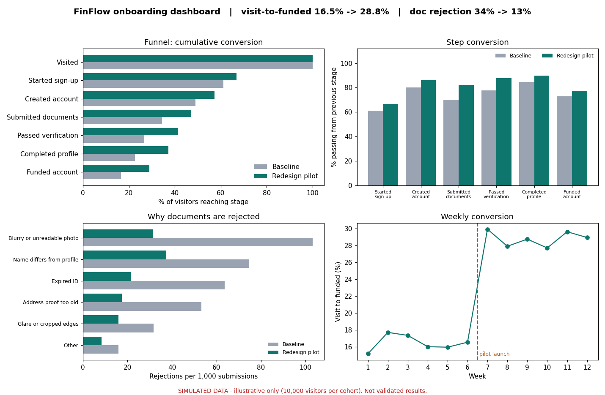

# FinFlow onboarding lab

A product-analytics case study: where applicants drop off between first visit and funded account, what a redesigned onboarding flow changes, and how to decide what to build first.

> **All data is simulated** (10,000 visitors per cohort, fixed seed). Results show that the analysis pipeline works; they are **not** evidence that the redesign works. Treat every effect as a **hypothesis** until a real A/B test confirms it. If you show this project in an interview, say so up front.



## Problem statement
Six in ten applicants who create an account never reach a funded balance. In the simulated baseline the largest loss after sign-up is at document submission (about 30% lost), and about a third of first submissions are rejected for fixable reasons. See [`docs/problem_statement.md`](docs/problem_statement.md).

## Features
- **Funnel dashboard:** baseline vs redesign pilot across seven stages, device filter (all/mobile/web), KPI cards, step conversion, median time per step, rejection reasons, weekly trend with launch marker, biggest-loss callout.
- **Prioritization:** nine features scored by reach x impact x confidence / effort, with Do now / Next / Later.
- **A/B test planner:** sample-size calculator and a z-test helper.
- **Bring your own data:** upload a CSV with the same schema in the sidebar.
- **Docs:** user journey, PRD, competitive benchmark framework, metrics and experiment plan.
- The interactive applicant-flow prototype (phone mock-up) lives in the separate single-page HTML lab, not in this repo.

## Architecture
```
data_generator.py  ->  data/onboarding_applications.csv  ->  analytics.py  ->  app.py (Streamlit)
                                                                   |             ^
                                              recommendations.py --+--- charts.py
```
| Path | Role |
|---|---|
| `app.py` | Streamlit UI (3 tabs) |
| `src/data_generator.py` | Seeded simulation; all assumptions live in constants at the top |
| `src/analytics.py` | Funnel, timing, rejection, KPI, weekly trend, z-test, sample size |
| `src/recommendations.py` | Feature scoring and stage pointers |
| `src/charts.py` | Matplotlib figures shared by the app and the screenshot |
| `tests/test_analytics.py` | 11 pytest checks |
| `docs/` | Product documentation |

## Installation
Python 3.10 or newer.
```bash
python -m venv .venv
source .venv/bin/activate        # Windows: .venv\Scripts\activate
pip install -r requirements.txt
```

## Running
```bash
python -m src.data_generator     # (re)creates data/onboarding_applications.csv
streamlit run app.py             # dashboard at http://localhost:8501
pytest                           # run tests
python -c "from src import analytics as a, charts; charts.dashboard_png(a.load(), 'assets/screenshots/dashboard.png')"   # refresh screenshot
```
Options: `python -m src.data_generator --n 50000 --seed 7`.

## Dataset schema (`data/onboarding_applications.csv`, 20,000 rows, one per visitor)
| Column | Type | Meaning |
|---|---|---|
| `applicant_id` | string | Synthetic ID |
| `cohort` | `baseline` / `pilot` | Old flow vs redesign |
| `device` | `mobile` / `web` | 62% / 38% of traffic |
| `week` | 1-12 | Baseline = weeks 1-6, pilot = weeks 7-12 |
| `furthest_stage` | 0-6 | 0 Visited ... 6 Funded account |
| `hours_to_started`, `hours_to_account`, `hours_to_docs`, `hours_to_verified`, `hours_to_profile`, `hours_to_funded` | float | Hours since the previous stage; blank if not reached |
| `first_submission_rejected` | bool | Only possible if documents were submitted |
| `rejection_reason` | string | Blank if not rejected |
| `support_contact` | bool | Status-related contact, only for applicants (account created) |

## Analytical methodology
- **Funnel:** users reaching stage *i* = rows with `furthest_stage >= i`. Step conversion = users(i) / users(i-1); cumulative = users(i) / visitors.
- **Timing:** median of hours per step among users who completed it.
- **Rejections:** first-submission rejections per 1,000 submitted documents, by reason.
- **Prioritization:** `reach% x impact(1-3) x confidence% / effort(weeks)`; top three are "Do now".
- **Significance:** pooled two-proportion z-test with unpooled 95% CI; sample size from the standard two-proportion formula (alpha 0.05, power 0.8).

Headline simulated output **[SIMULATED]**: visit-to-funded 16.5% -> 28.8%, application completion 70% -> 82%, first-submission rejection 34% -> 13%, median verification 25h -> 9h.

## Assumptions
- Stage pass rates, timing medians (lognormal, sigma 0.8), rejection mix, device effects and support-contact rates are inputs chosen to mirror the lab page, set in `src/data_generator.py`. The pilot results are therefore built in, not discovered.
- Device multipliers are normalised so overall rates match the stated pass rates.
- "Applicant" means a visitor who created an account.
- Prioritization inputs (reach, impact, confidence, effort) are judgement calls.

## Limitations
- Synthetic data: no real-world noise, seasonality, bot traffic, or correlated behaviour.
- Cohorts are separated in time (weeks 1-6 vs 7-12), so the trend is a before/after comparison with possible confounds. The proposed real test is randomised.
- Rejected applicants are not modelled through resubmission loops; "passed verification" is a simple stage pass rate.
- Fraud false-accept rate and manual review cost are guardrails in the plan but not simulated.
- Weekly cohorts hold about 1,650 visitors, so weekly conversion moves by roughly +/-1 pp from noise alone.
- The competitive benchmark is an unfilled framework; no competitor research was done.

## Future enhancements
- Load real funnel exports and event logs; add event-level instrumentation (R6).
- A/B readout view with CI, SRM check and sequential-testing guardrails.
- Resubmission loop and fraud/cost simulation.
- Segment cuts beyond device (acquisition channel, phone model).
- Sensitivity analysis on prioritization inputs.
- Fill in the competitive benchmark from hands-on testing.

## Evidence labels used in the docs
**[SIMULATED]** output of the generator; **[HYPOTHESIS]** expected effect to test; **[VALIDATED]** confirmed by a real experiment (none yet).
